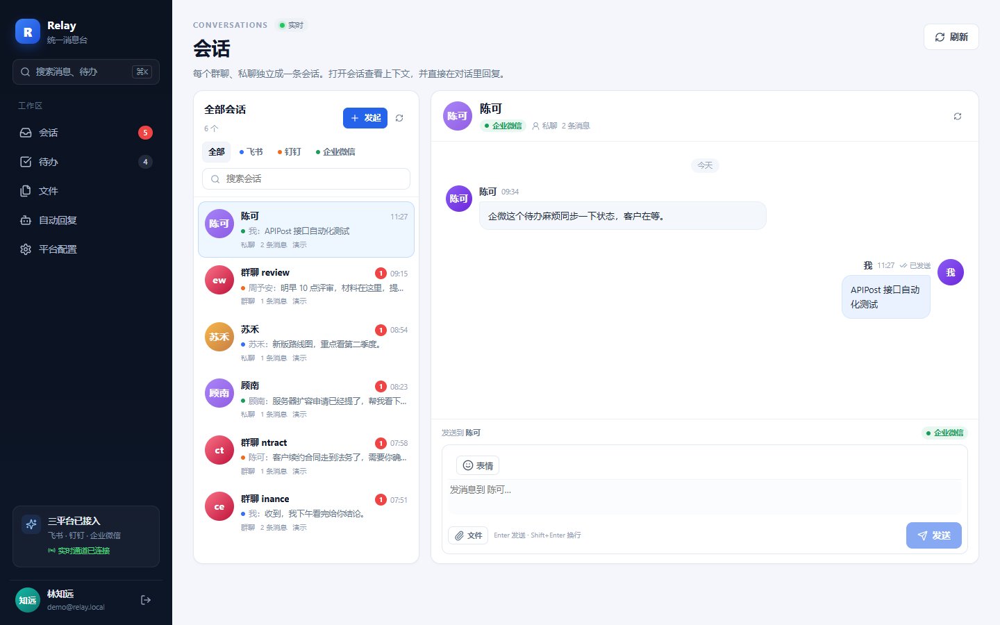

# Relay · 多平台 IM 统一工作台

Relay 把飞书、钉钉、企业微信的消息、任务、文件和联系人收进一个 Web 工作台，完成：

```text
注册 / 登录 → 配置平台 → 查看联系人与新消息 → 选择联系人发送
→ 人工 / 自动回复 → 消息转待办 → 状态回写 → 实时更新
```

项目重点不是简单转发消息，而是统一会话、任务、文件和身份模型，并把平台差异封装在 Adapter 层。

仓库地址：<https://github.com/pupil-1102/relay-multi-platform-im>



## 功能

### 1. 账号与平台配置

- 邮箱 + 密码注册、登录、改密（PBKDF2-HMAC-SHA256 加盐哈希）；
- 飞书、钉钉、企业微信 OAuth 登录；
- 同一邮箱的平台身份可合并；不同账号不会静默切换或合并；
- 平台凭据可在页面填写，Fernet 加密落库，保存后热加载 adapter/runner，无需重启；
- 支持解绑单个平台身份和迁移历史数据。

### 2. 统一会话与消息

- 群聊、私聊拆成独立会话；
- 显示最后消息、发送人、时间、未读数和平台来源；
- 会话内查看完整上下文，支持文本、图片、文件、引用回复、群内 @ 和表情；
- 出站消息显示 `pending / sent / failed`；
- WebSocket 实时推送，5 秒轮询兜底；
- 平台消息 ID 去重，`processed_events` 保证事件幂等。

### 3. 任务闭环

- 任意消息可转为统一待办；
- 同步飞书任务、钉钉待办；
- 完成 / 进行中 / 重新打开状态回写；
- `sync_token + expected_status + TTL` 抑制平台事件回音；
- 同一任务可关联多个平台任务，完成状态可跨平台传播。

### 4. 文件中心

- 三平台附件统一入库；
- 图片、PDF、文本在线预览，其他类型下载；
- 记录打开次数，可定位回原消息；
- 企业微信加密文件通过 aibot `aeskey` 解密。

### 5. 自动回复

- 关键词 / 兜底规则；
- 平台范围、优先级、同会话冷却；
- 回显与自身消息护栏；
- `{{sender_name}}`、`{{platform}}`、`{{rule_name}}` 模板变量；
- 文本或附件应答，记录命中次数与触发日志。

### 6. 多账号与个人镜像

- 可选多用户通道：按 owner 拆分 user-token 镜像；
- 飞书 UAT（用户身份令牌）拉取个人会话；
- 钉钉 DWS（DingTalk Workspace CLI）读取本机登录态个人待办 / 消息事件；
- `dws` 只有一个登录态，多账号模式下只绑定第一个 owner，状态接口会明确标注 `bot_owner_id`。

## 架构

```text
React 19 + TypeScript + Vite
  ├─ 会话 / 任务 / 文件 / 自动回复 / 平台配置 / 登录
  ├─ TanStack Query + WebSocket 实时事件
  └─ 前端不接触任何平台 Secret

FastAPI + SQLAlchemy 2 async + SQLite/Alembic
  ├─ /api/conversations       会话与消息
  ├─ /api/tasks               统一任务
  ├─ /api/files               文件中心
  ├─ /api/contacts            联系人同步 / 查询
  ├─ /api/auth/*              注册、登录、OAuth、解绑
  ├─ /api/platforms/*         平台配置（加密 + 热加载）
  ├─ /api/auto-reply/*        自动回复规则 / 附件 / 日志
  ├─ /ws                      前端实时事件总路线
  └─ services/                ingest、send、tasks、sync、files、auto_reply
       └─ platform/           Mock / 飞书 / 钉钉 / 企业微信 Adapter
```

## 快速开始

环境要求：Windows / macOS / Linux，Python 3.11+，Node 18+。

```powershell
git clone https://github.com/pupil-1102/relay-multi-platform-im.git
cd relay-multi-platform-im

python -m venv .venv
.\.venv\Scripts\python.exe -m pip install -r backend\requirements-dev.txt

npm --prefix frontend install
npm --prefix frontend run build
```

启动：

```powershell
.\start.bat
# 或
powershell -ExecutionPolicy Bypass -File .\start.ps1
```

打开 <http://127.0.0.1:8000>。

开发模式：

```powershell
.\.venv\Scripts\python.exe -m uvicorn backend.app.main:app --reload --port 8000
npm --prefix frontend run dev
# http://127.0.0.1:5173
```

## Mock / 演示模式

默认 mock 模式不依赖任何平台凭据，三平台消息、引用回复、待办、文件、自动回复都可操作：

```env
DEMO_MODE=true
```

真实模式需要按平台创建应用、配置权限和回调，复制 `.env.example` 为 `.env` 后填写凭据：

```env
DEMO_MODE=false
DEV_LOGIN=false
SEED_DEMO=false
ENABLE_REAL_CHANNELS=true
```

真实凭据只放在本地 `.env` 或平台配置页，不随仓库提供。

## 测试与验证

```powershell
.\.venv\Scripts\python.exe scripts\run_tests.py -q
npm --prefix frontend run build
```

当前验证结果：

- 后端 `pytest`：**93 项通过**；
- 前端 `npm run build`：通过；
- APIPost 接口自动化：覆盖 10 个核心 HTTP 接口，接口 / 断言通过率 100%；
- 演示截图使用 mock 数据，不包含真实平台凭据或真实客户资料。

## 能力边界

- 企业微信受企业认证、可信域名、会话存档权限限制；
- 当前只验证 **企业微信智能机器人（aibot）单聊**的文本、图片、PDF 接收与回复，项目内部称这一最小链路为 **P0-lite**；
- P0-lite 不包含企业微信通讯录、应用回调、服务端待办、个人聊天存档等完整应用能力；
- 外部联系人模块尚未实现，不在本项目能力声明内；
- 钉钉单聊引用回复需要 `dws` 用户态登录；未启用时会明确报错，不静默降级。

## 目录

```text
backend/
  app/
    api/            REST + WebSocket 路由
    platform/       Mock / 飞书 / 钉钉 / 企业微信 Adapter
    services/       入站、发送、任务、防回音、文件、自动回复、认证
    migrations/     Alembic
    models.py       SQLAlchemy 模型
  tests/
frontend/
  src/
    components/
    pages/
    api.ts
scripts/
start.ps1
start.bat
```

## 隐私与安全

- `.env`、数据库、本地附件、真实截图、演示录屏和提交材料不进入仓库；
- `.env.example` 只提供占位符；
- README 截图来自 mock 演示数据；
- 平台 Secret、Token 通过环境变量或页面加密存储，接口不回显密钥；
- 如果你部署到公网，请先设置随机 `SECRET_KEY`、关闭 `DEV_LOGIN`，并限制平台回调来源。

## 说明

项目用于多平台 IM 聚合与业务闭环的工程实践。平台接入受各平台应用权限、企业认证和接口能力限制，实际可用能力以运行环境为准。
